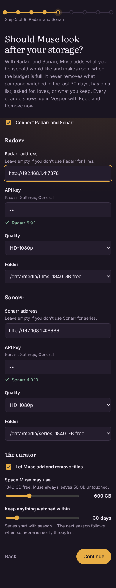
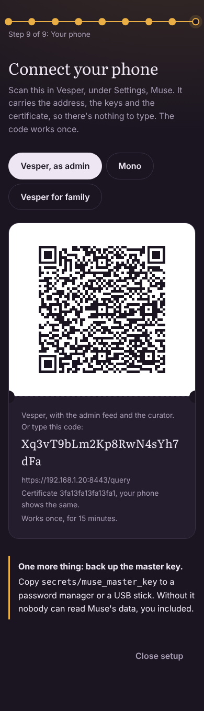

# Installing Muse

Muse is a backend: it learns from Jellyfin (and whatever else you connect) and serves
recommendations to clients such as Vesper and the Jellyfin plugin. Setup is one command.

## Before you start

* A Linux host (VM, LXC or bare metal) with **Docker and Docker Compose v2**, and Python 3.9+
  (only for the `./muse` tool; no packages needed).
* 8 GB RAM minimum, 16 GB+ for the default embedding model on CPU, or an NVIDIA GPU. 15 GB disk.
* A **Jellyfin API key**: Jellyfin Dashboard > API Keys > +.
* Optional but recommended: a free **TMDB API key** (https://www.themoviedb.org/settings/api).
  It adds keywords, cast and "fans also liked" to every title. TMDB only sees which titles are
  looked up, never who watched what.

Muse holds a behavioural profile of your household. Give it its own VM/LXC if you can, keep it
off the public internet, and read [SECURITY.md](../SECURITY.md).

## Install

One line, on the machine that will run Muse:

```bash
curl -fsSL https://raw.githubusercontent.com/madmaxvoltro/Muse/main/install.sh | bash
```

It checks for Docker (and offers to install it), Python and git, puts Muse in `/opt/muse` (as
root) or `~/muse`, and starts the setup. Running it again updates Muse and keeps your keys and data.

On **Proxmox**, run one of these on the host instead; they create the machine and run the line above in it:

```bash
# a container (light; Docker runs inside with nesting)
bash -c "$(curl -fsSL https://raw.githubusercontent.com/madmaxvoltro/Muse/main/deploy/proxmox/muse-lxc.sh)"
# a VM (for GPU passthrough, or if you'd rather not run Docker in a container)
bash -c "$(curl -fsSL https://raw.githubusercontent.com/madmaxvoltro/Muse/main/deploy/proxmox/muse-vm.sh)"
```

Defaults: 4 cores, 8 GB RAM, 32-40 GB disk, DHCP on `vmbr0`. Change them with environment
variables (`CORES=6 MEMORY=16384 bash -c "$(curl ...)"`, see the top of each script).

Or by hand:

```bash
git clone https://github.com/madmaxvoltro/Muse.git muse && cd muse
./muse setup          # in the terminal
./muse setup --web    # in your browser, also on your phone: the terminal shows a QR code
```



The setup asks a few questions and then does everything. In the browser every answer is checked
as you type (Jellyfin shows its name and number of users, Radarr and Sonarr their quality
profiles and folders with free space):

1. checks Docker, memory, disk and GPU;
2. asks who should reach Muse:
   * **devices at home** (`lan`): phones, TVs and computers on your network, over HTTPS with Muse's own certificate;
   * **my devices, anywhere** (`tailscale`): over Tailscale, HTTPS on your tailnet address;
   * **only this machine** (`local`): the most private; phones can't connect;
3. checks your Jellyfin URL and key;
4. checks your TMDB key (optional);
5. **Radarr and Sonarr** (optional): connects them, picks the quality profile and folder, and
   asks whether Muse may manage a storage budget (the curator, see below) and how much;
6. picks an embedding model for your hardware, and optionally an LLM;
7. generates every secret into `secrets/` (never replacing existing ones);
8. downloads ready-made images (or builds them when it can't), starts Muse, applies database
   migrations and verifies it's up.

At the end it shows a **QR code**: scan it in Vesper (Settings, Muse) and your phone is connected,
as the admin, with nothing to type. See [Connecting clients](#connecting-clients).

**Back up `secrets/muse_master_key`** somewhere safe and separate (a password manager, a USB
stick). Everything personal Muse stores is encrypted with it. Without it nobody can read the
data, including you.

Non-interactive, for automation:

```bash
./muse setup --mode local --jellyfin-url http://127.0.0.1:8096 --jellyfin-key "$KEY" --tmdb-key "$TMDB" --yes
# with the curator:
./muse setup --mode lan --jellyfin-url ... --radarr-url http://10.0.0.4:7878 --radarr-key "$R" \
  --sonarr-url http://10.0.0.4:8989 --sonarr-key "$S" --curator --budget-gb 500 --yes
```

Ready-made images come from `ghcr.io/madmaxvoltro/muse-*` (amd64 and arm64,
`docker-compose.images.yml`). With an NVIDIA GPU, or when a download fails, Muse builds its
images locally instead (`MUSE_BUILD=local` in `.env` keeps it that way). Pin a version with
`MUSE_IMAGE_TAG=1.2.0`.

## First hours

The first worker cycles download the embedding model, read your whole Jellyfin library, enrich
it from TMDB and embed it. On CPU that can take an hour or two for a large library. Follow it
with:

```bash
./muse status          # services, worker progress, catalog, queue
./muse status --url    # link to the status page
./muse logs embedding-worker
```

Then bring in history from elsewhere so Muse doesn't start cold:

```bash
./muse users                                          # your user ids (the Jellyfin user GUIDs)
./muse import letterboxd letterboxd-export.zip --user <id>
./muse import netflix ViewingActivity.csv --user <id> --profile "Your profile name"
./muse import youtube takeout.zip --user <id>
```

Kinds: `youtube`, `spotify`, `soundcloud`, `letterboxd`, `imdb`, `netflix`, `trakt`
([details](recommender.md#9-importing-history-on-onboarding)).

## Day to day

| | |
|---|---|
| `./muse status` | is everything healthy, how far is the worker |
| `./muse doctor` | finds problems and says how to fix them |
| `./muse pair` / `./muse invite` | QR code to connect a phone, Mono, or a family member |
| `./muse curator` | the storage budget: status, keep, remove, pause |
| `./muse upgrade` | pull, rebuild, restart (migrations run automatically) |
| `./muse backup` / `./muse restore FILE` | encrypted backups |
| `./muse export-user ID` / `./muse forget-user ID` | everything about one person, or delete it |
| `./muse rotate-keys` | new encryption key, re-encrypt all data |
| `./muse logs [service]`, `./muse restart [service]`, `./muse down`, `./muse up` | the usual |

## Optional parts

Enable them with `COMPOSE_PROFILES` in `.env` (comma separated), then `./muse up`:

| profile | what | needs |
|---|---|---|
| `curator` | storage-budget manager (adds and removes titles through Radarr/Sonarr, see [the curator](#the-curator-muse-looks-after-your-storage)); `./muse setup` turns it on | `RADARR_URL`/`SONARR_URL` in `.env`, keys in `secrets/radarr_api_key` / `secrets/sonarr_api_key` |
| `arr` | the arr-stack adapter (watchlist/rejection signal) | same |
| `searxng` | SearxNG search history adapter | `SEARXNG_UPSTREAM_URL` |
| `mcp` | MCP server so an assistant can ask you Muse's questions | `MUSE_MCP_USER_ID` |
| `tls` | HTTPS for other machines (set automatically in lan/tailscale mode) | |

GPU: setup detects an NVIDIA GPU and adds `docker-compose.gpu.yml` (needs the NVIDIA Container
Toolkit). It also offers an optional local Ollama for the LLM features.

## The curator: Muse looks after your storage

With Radarr and Sonarr connected and the curator on, Muse keeps a storage budget full of what
your household would like:

* **Adds** titles the household would enjoy, within the budget, a daily limit per person, and
  always leaving 50 GB free on the disk (`MUSE_CURATOR_MIN_FREE_GB`). Everything it adds carries
  the tag `muse` in Radarr/Sonarr. Series start with **season 1**; the next season follows when
  someone is nearly through what's there.
* **Removes** only when over budget, and first puts a title on **Soon Gone** for 48 hours. It
  never removes a title that:
  * someone watched in the last 30 days (`MUSE_CURATOR_RECENT_DAYS`; for a series, any episode),
  * someone is part-way through,
  * is on someone's list (Vesper, Jellyfin, Trakt, Letterboxd, IMDb...),
  * someone asked for, or marked as a favourite or loved,
  * you chose to keep.

  These rules are checked again right before anything is removed, so watching it or putting it
  on a list during Soon Gone saves it.
* **Only touches what is its own**: titles it added, and titles you tag `muse` yourself in
  Radarr/Sonarr (it adopts those). Everything else is never touched.
* **Tells you** in Vesper (admin only) about every add, Soon Gone, save and removal, with **Keep**
  and **Remove now**. A webhook for the `admin` event sends the same to Discord, Home Assistant, n8n.

From the terminal:

```bash
./muse curator                       # budget bar, Soon Gone, what it did lately
./muse curator keep movie 603        # never remove it
./muse curator remove series 1399    # remove now
./muse curator budget 800            # GB
./muse curator pause | resume | run
```

## Connecting clients

The easy way: **scan a QR code**. It carries the addresses, the keys and the certificate's
fingerprint, works once and expires.

```bash
./muse pair            # Vesper on your phone (add --admin for the curator's notices and controls)
./muse pair admin      # the same as --admin
./muse pair mono       # Mono: paste the code in Mono's Muse settings, or scan it
./muse invite          # Vesper for someone in the family (valid a day)
```



The QR holds `muse://pair?u=<query API>&c=<code>&fp=<certificate SHA-256>`. The app checks the
certificate against `fp`, redeems the code once at `POST <u>/v1/pair` and receives its
configuration (details in [vesper.md](vesper.md#pairing-and-the-admin-feed)).

By hand:

* **Vesper**: Recommendation API URL + the Vesper read key (for recommendations, profile,
  evolution, questions), and the Ingestion API URL + the Vesper answer key (for answers and
  history uploads).
* **Jellyfin plugin**: Recommendation API URL + the plugin read key.
* In lan/tailscale mode the URLs are `https://<host>:8443/reco`, `/ingest` and `/query`, and
  clients must trust Muse's certificate: `./muse ca > muse-ca.crt`.

## Troubleshooting

`./muse doctor` checks permissions, secrets, containers, exposure, migrations, the worker,
Jellyfin and TMDB, and explains each problem. Common ones:

* **Jellyfin unreachable from the adapter**: in local mode with Jellyfin on `127.0.0.1`, setup
  uses host networking for the adapter (`docker-compose.vesper.yml`). If Jellyfin runs in another
  Docker network, use its LAN address as `JELLYFIN_URL`.
* **401 from an API**: the client's key doesn't match `secrets/read_keys` (reads) or
  `secrets/adapter_keys` (writes). `./muse keys` shows the right ones.
* **503 "no read keys configured"**: `secrets/read_keys` is empty. Run `./muse setup` again.
* **Upgrading from an install before encryption**: `./muse upgrade` encrypts existing rows
  automatically (the admin step) and rebuilds derived data; nothing to do by hand.

## Music, Mono and AI assistants

The query API, the vector worker and the scheduler start with the rest. Two more parts are
behind the `music` profile (add it to `COMPOSE_PROFILES` in `.env`):

- `catalog` reaches musicbrainz.org, api.listenbrainz.org, labs.api.listenbrainz.org and
  api.deezer.com for music beyond your library and new releases of loved artists. Leave the
  profile off to keep taste entirely in the house.
- `audio-analyzer` listens to music (tempo, key, energy, and an audio model for how it sounds).
  It downloads its model (~600 MB) on first start. Set `MUSE_MONO_URL` so it can stream Mono's
  files, and put the value of `secrets/mono_stream_token` in Mono as `MONO_MUSE_STREAM_TOKEN`.
  CPU by default; with an NVIDIA GPU use `docker-compose.gpu.yml`.

**Mono** talks to Muse directly. In Mono's environment set:

```bash
MONO_MUSE_INGEST_URL=http://<muse>:8771     # events
MONO_MUSE_REC_URL=http://<muse>:8770        # recommendations, radio, next-track
MONO_MUSE_QUERY_URL=http://<muse>:8772      # the Muse screen: questions, facts, linked accounts, tokens
MONO_MUSE_API_KEY=<the mono: key in secrets/adapter_keys>
MONO_MUSE_READ_KEY=<the query: key in secrets/read_keys, or a key of its own added there>
```

**AI assistants** (Claude Desktop, Claude Code, any MCP client): start the MCP server with the
`mcp` profile, then mint a personal token per person (`POST /v1/tokens` with
`secrets/admin_token`, or from Mono's Settings, Muse, "Connect an AI assistant"). See
[`services/mcp-server/README.md`](../services/mcp-server/README.md).

**Vesper** uses the recommendation API with a read key from `secrets/read_keys` (`vesper:`), the
ingestion API with the `jellyfin:` key, and the query API with that same key plus `X-Muse-User`
for linking profiles and watching together; see
[`vesper.md`](vesper.md).

`./muse setup` creates every secret these parts need, also on an install that predates them
(existing secrets are never replaced; the `mono:` and `query:` keys are added to the key lists).
